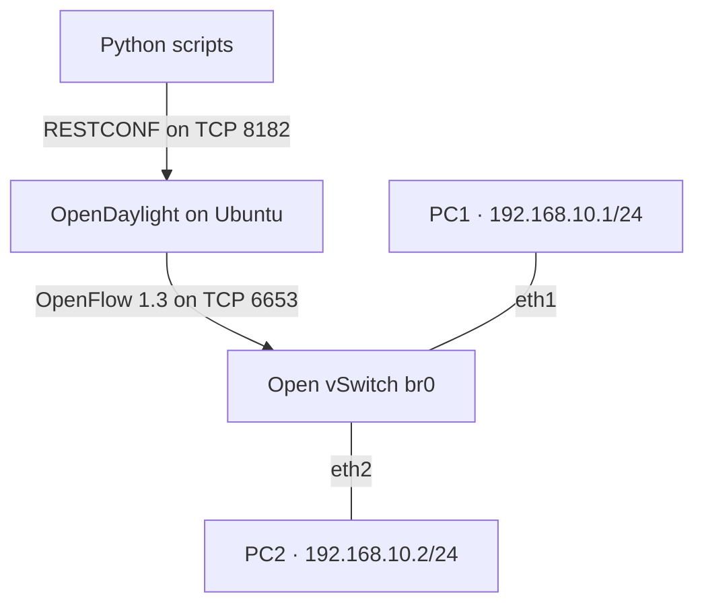

# Software-Defined Networking Lab

I built a GNS3 lab to see how a controller programs a switch and how to prove that a policy is enforced. I used Python and RESTCONF to inspect OpenDaylight's inventory and manage an ICMP drop rule. I verified the result from the endpoints and checked the OpenFlow counters directly on Open vSwitch.

In the recorded Lab 1 test, PC2's ping to PC1 went from **5/5 replies** to **0/5** after installing the rule. Open vSwitch counted **5 matching packets (490 bytes)**. After I removed the rule, the ping returned to **5/5 replies**. See the [original firewall results](security/README.md).

## Topology



OpenDaylight ran on a separate Ubuntu VM at `192.168.56.102`. The switch reached it through the management interface `eth0` at `192.168.56.250`, connected to Cloud2 in the [saved GNS3 topology](gns3/SDN-OpenFlow-Lab.gns3). Host traffic crossed `br0` between the two data ports. The scripts ran on the controller VM and used RESTCONF on localhost.

## Policy and results

| Table 0 flow | Priority | Match | Action |
| --- | ---: | --- | --- |
| 1 | 100 | Ingress OpenFlow port 1 | Output to port 2 |
| 2 | 100 | Ingress OpenFlow port 2 | Output to port 1 |
| 100 | 200 | IPv4 ICMP from `192.168.10.2` to `192.168.10.1` | Drop |

The first two rules forward traffic between the test hosts. Flow 100 takes precedence when its match applies. It matches ICMP in the PC2-to-PC1 direction, so a ping initiated from PC1 can also fail if its echo reply matches the drop rule. The recorded test below was initiated from PC2.

| Lab 1 stage | PC2 ping to PC1 | Switch evidence |
| --- | --- | --- |
| Baseline | 5/5 replies | Priority-100 forwarding flows in table 0 |
| Flow 100 installed | 0/5 replies | Drop flow matched 5 packets and 490 bytes |
| Flow 100 removed | 5/5 replies | Endpoint connectivity recovered |

The repo includes the [baseline flow snapshot](backups/br0-table0-working.json) and the [tested firewall policy](security/block-icmp.json).

## Troubleshooting an HTTP 409

While adding the policy, OpenDaylight returned HTTP 409. I corrected the table path under the switch node to use `flow-node-inventory:table=0/flow=100`. After the request succeeded, I checked the operational flow, dumped the switch's installed entries, and ran the ping test. That let me confirm the controller had accepted the change and the switch was enforcing it.

## Repeat the demo

The recorded setup used GNS3 2.2.61, an OpenDaylight controller running in Karaf 0.24.0, OpenFlow 1.3, and Python 3 with `requests`. The GNS3 topology references `gns3/openvswitch:latest`. Bring up the external controller separately and confirm RESTCONF is available at `http://localhost:8182/restconf/data` from the controller VM.

1. Open the [GNS3 project](gns3/SDN-OpenFlow-Lab.gns3). Start the switch and endpoints. Use `show ip` from each VPCS console and confirm the two addresses shown in the diagram. Configure the switch management attachment so it can reach the controller on TCP 6653.
2. In the switch console, run these commands to check the controller connection, datapath ID, OpenFlow port mapping, and baseline flows. The two forwarding entries need to be installed for the demo. Use the saved snapshot as the reference for those entries and verify the port numbers in your topology before configuring them.

   ```sh
   ovs-vsctl --columns=target,is_connected list Controller
   ovs-vsctl get Bridge br0 datapath_id
   ovs-ofctl -O OpenFlow13 show br0
   ovs-ofctl -O OpenFlow13 dump-flows br0
   ```

3. On the controller VM, run `python3 odl_topology.py` from the repository root. It reports controller-discovered nodes and reads table 0 for Lab 1. The firewall scripts also use a fixed switch ID.

   | Lab | Controller node ID | Script |
   | --- | --- | --- |
   | 1 | `openflow:187176127603778` | [sdn_firewall.py](sdn_firewall.py) |
   | 2 | `openflow:125423032627785` | [sdn_firewall_lab2.py](sdn_firewall_lab2.py) |

   For a new switch, use the node ID printed by the topology script. The topology listing runs before the fixed table lookup. Update the fixed ID for that lookup and the firewall script you are using, keeping the colon encoded as `%3A` in RESTCONF URLs. The scripts prompt for the controller password. Run the firewall script from the repository root so it can open the policy JSON.

4. From PC2, run `ping 192.168.10.1` and confirm the baseline succeeds. From the controller VM, run the following for Lab 1. Confirm flow 100 is absent before installing it.

   ```sh
   python3 sdn_firewall.py check
   python3 sdn_firewall.py install
   python3 sdn_firewall.py check
   ```

5. Repeat the ping from PC2. It should time out. Run `ovs-ofctl -O OpenFlow13 dump-flows br0` again and check that the priority-200 drop entry's packet counter increased.
6. If the script installed the rule in step 4, run `python3 sdn_firewall.py remove`, then `python3 sdn_firewall.py check`. Confirm the drop entry is gone from the switch and run the ping from PC2 again to verify recovery.

The original lab notes also record management networking persistence, controller reconnection, and forwarding restoration after an OVS restart. Controller VM restart and full-lab shutdown recovery remain unverified.
